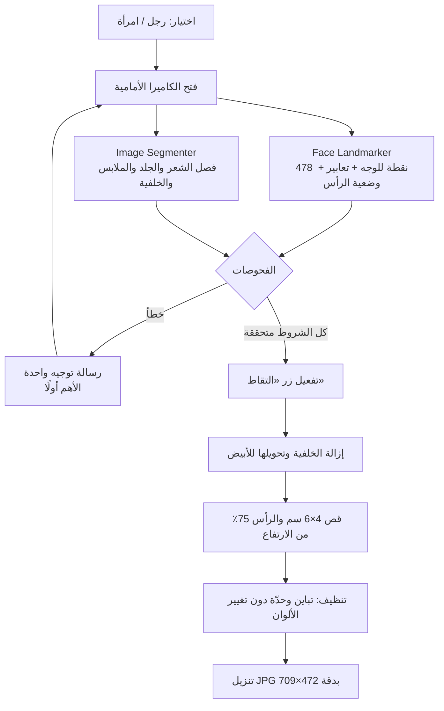

<div align="center">


# مباشر

**صورة شخصية بمواصفات الأحوال المدنية، من جوالك مباشرة**

أداة ويب مجانية توجّهك لحظيًا بالعربية أثناء التصوير، وتمنع الأخطاء قبل أن تقع،
ثم تُخرج صورة 4×6 سم بخلفية بيضاء جاهزة للرفع في أبشر.

[جرّب الأداة](https://7sh-mk.github.io/mubashir/) · [إرشادات التصوير](https://7sh-mk.github.io/mubashir/guide.html) · [سياسة الخصوصية](https://7sh-mk.github.io/mubashir/policy.html)

</div>

---

## الفكرة

الأدوات الموجودة تصلح صورة ملتقطة مسبقًا. «مباشر» يعمل بالعكس: يراقب الكاميرا لحظة بلحظة،
وينبّه إلى الخطأ وقت حدوثه (الميلان، المسافة، الظل، النظر، الحجاب، الغترة)، فلا يُفعَّل زر
الالتقاط إلا عندما تكون الصورة مطابقة للشروط.

- **بلا خادم ولا تكلفة:** كل شيء يعمل داخل المتصفح، ويُستضاف على GitHub Pages.
- **الخصوصية أولًا:** الصورة لا تُحفظ ولا تُرفع، وكل المعالجة على جهاز المستخدم.
- **عربي أولًا:** واجهة من اليمين إلى اليسار، ورسائل بصيغة المذكر أو المؤنث حسب الاختيار.

## سير العمل



## ما الذي يفحصه

| الفئة | الفحص | الرسالة |
| --- | --- | --- |
| الوضعية | المسافة والتوسيط داخل الإطار البيضاوي | «اقترب قليلًا» / «حرّك الجوال إلى اليمين» |
| | ميلان الرأس والتفاته | «حافظ على استقامة رأسك» / «اجعل وجهك مقابلًا للكاميرا» |
| | اتجاه النظر | «انظر إلى الأمام نحو الكاميرا مباشرة» |
| الإضاءة | إضاءة ضعيفة أو قوية | «الإضاءة ضعيفة، اقترب من مصدر الضوء» |
| | ظل على أحد جانبي الوجه | «يوجد ظل على الجانب الأيمن من وجهك…» |
| الوجه | تغطية الوجه أو الذقن | «الحجاب يغطي جزءًا من وجهك…» |
| | اليد في الصورة | «أبعد يدك عن الصورة» |
| الرجال | الغترة أو الشماغ | «ارتدِ الغترة أو الشماغ» |
| النساء | الشعر، الجبهة، الأذنان، الرقبة، شدّ الحجاب | «غطّي الشعر بالحجاب» / «ارفعي الحجاب عن جبهتك»… |
| الجهاز | دقة الكاميرا ووضوحها | تنبيه باستخدام جهاز آخر |

الشروط مأخوذة من دليل صور الأحوال المدنية في منصة أبشر، ومن معيار ICAO لصور الوثائق
(إضاءة متساوية، وظهور الوجه من الذقن إلى الجبهة مع حدّيه).
ما لا يمكن كشفه آليًا (العدسات اللاصقة، مساحيق التجميل) يظهر تذكيرًا قبل التصوير.

## التقنيات

| الأداة | الدور |
| --- | --- |
| [MediaPipe Face Landmarker](https://ai.google.dev/edge/mediapipe/solutions/vision/face_landmarker) | نقاط الوجه، اتجاه النظر، زوايا الرأس |
| [MediaPipe Image Segmenter](https://ai.google.dev/edge/mediapipe/solutions/vision/image_segmenter) (multiclass) | فصل الشعر والجلد والملابس والخلفية |
| `getUserMedia` | الكاميرا الأمامية |
| Canvas | قياس الإضاءة، تبييض الخلفية، القص، حفظ JPG |
| HTML / CSS / JavaScript | صفحة ثابتة بلا إطار عمل ولا خطوة بناء |

## هيكل المشروع

```
index.html     واجهة التصوير
guide.html     إرشادات التصوير للنساء والرجال
policy.html    الخصوصية وشروط الاستخدام
style.css      الهوية البصرية (فاتح وداكن)
app.js         الكاميرا وحلقة التحليل والواجهة
checks.js      الفحوصات (دوال نقية: أرقام تدخل، رسالة تخرج)
config.js      كل الحدود والمقاسات والرسائل في مكان واحد
export.js      إزالة الخلفية، القص، التنظيف، JPG
favicon.svg    الشعار
assets/        صور النماذج المقبولة
```

## التشغيل محليًا

```bash
npx http-server -p 8080 -c-1
```

ثم افتح `http://localhost:8080`. الكاميرا على الجوال تحتاج HTTPS، فاستخدم نفقًا مؤقتًا:

```bash
cloudflared tunnel --url http://localhost:8080
```

أضف `?debug` إلى الرابط لعرض القيم الحية خلف كل فحص، واضبط الحدود من `config.js`.

## إخلاء مسؤولية

«مباشر» أداة مستقلة وغير تابعة لأبشر أو وكالة الأحوال المدنية أو أي جهة حكومية.
الإرشادات اجتهاد تقني لا يضمن قبول الصورة، والقرار النهائي للجهة المختصة.

## الحقوق

© 2026 شريفة الزبيدي. جميع الحقوق محفوظة.

---

<div dir="ltr">

**Mubashir** is a free, client-side web app that guides users live (in Arabic) while taking a
Saudi Civil Affairs ID photo, blocks capture until every requirement is met, then removes the
background and exports a 4×6 cm white-background JPG ready for Absher. Built with MediaPipe
Face Landmarker and Image Segmenter, plain HTML/CSS/JS, no server, and no data ever leaves the device.

</div>
