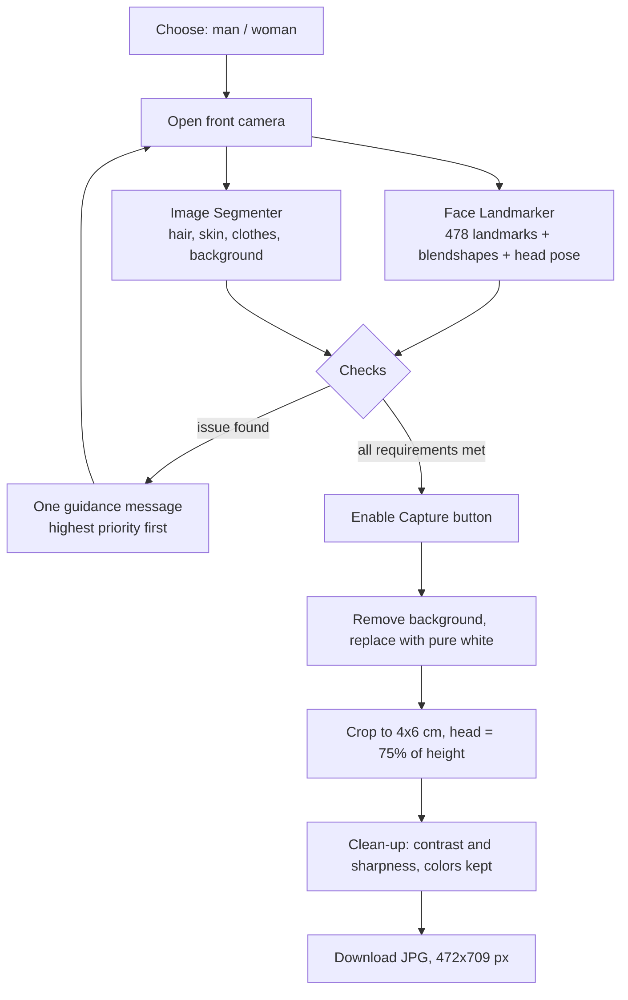

<div align="center">


# مباشر

**صورة شخصية بمواصفات الأحوال المدنية**

أداة ويب مجانية توجّهك لحظيًا بالعربية أثناء التصوير،
وتتيح تنزيل الصورة بحجم 4×6 سم وبخلفية بيضاء جاهزة للرفع في أبشر.

[جرّب الأداة](https://7sh-mk.github.io/mubashir/) · [إرشادات التصوير](https://7sh-mk.github.io/mubashir/guide.html) · [سياسة الخصوصية](https://7sh-mk.github.io/mubashir/policy.html)

</div>

---

## الفكرة

الأدوات الموجودة تصلح صورة ملتقطة مسبقًا. «مباشر» يعمل بالعكس: يراقب الكاميرا لحظة بلحظة،
وينبّه إلى الخطأ وقت حدوثه (الميلان، المسافة، الظل، النظر، الحجاب، الغترة)، فلا يُفعَّل زر
الالتقاط إلا عندما تكون الصورة مطابقة للشروط.

- **مجانا:** كل شيء يعمل داخل المتصفح، ويُستضاف على GitHub Pages.
- **الخصوصية:** الصورة لا تُحفظ ولا تُرفع، وكل المعالجة على جهاز المستخدم.
- **باللغه العربية:** واجهة من اليمين إلى اليسار، ورسائل بصيغة المذكر أو المؤنث حسب الاختيار.

<div dir="ltr">

## Workflow



</div>

## ما الذي يفحصه

| الفئة | الفحص | الرسالة |
| --- | --- | --- |
| الوضعية | المسافة والتوسيط داخل الإطار البيضاوي | «اقترب قليلًا» / «حرّك الجوال إلى اليمين» |
| | ميلان الرأس والتفاته | «حافظ على استقامة رأسك» / «اجعل وجهك مقابلًا للكاميرا» |
| | اتجاه النظر | «انظر إلى الأمام نحو الكاميرا مباشرة» |
| الإضاءة | إضاءة ضعيفة أو قوية | «الإضاءة ضعيفة، اقترب من مصدر الضوء» |
| | ظل على أحد جانبي الوجه | «يوجد ظل على الجانب الأيمن من وجهك…» |
| الوجه | تغطية الوجه أو الذقن | «الحجاب يغطي جزءًا من وجهك…» |
| | اليد في الصورة | «أبعد يدك عن الصورة» |
| الرجال | الغترة أو الشماغ | «ارتدِ الغترة أو الشماغ» |
| النساء | الشعر، الجبهة، الأذنان، الرقبة، شدّ الحجاب | «غطّي الشعر بالحجاب» / «ارفعي الحجاب عن جبهتك»… |
| الجهاز | دقة الكاميرا ووضوحها | تنبيه باستخدام جهاز آخر |

الشروط مأخوذة من دليل صور الأحوال المدنية في منصة أبشر، ومن معيار ICAO لصور الوثائق
(إضاءة متساوية، وظهور الوجه من الذقن إلى الجبهة مع حدّيه).
ما لا يمكن كشفه آليًا (العدسات اللاصقة، مساحيق التجميل) يظهر تذكيرًا قبل التصوير.

<div dir="ltr">

## Tech stack

| Tool | Role |
| --- | --- |
| [MediaPipe Face Landmarker](https://ai.google.dev/edge/mediapipe/solutions/vision/face_landmarker) | Face landmarks, gaze direction, head pose |
| [MediaPipe Image Segmenter](https://ai.google.dev/edge/mediapipe/solutions/vision/image_segmenter) (multiclass) | Separates hair, skin, clothes and background |
| `getUserMedia` | Front camera access |
| Canvas API | Lighting analysis, white background, crop, JPG export |
| HTML / CSS / JavaScript | Static site, no framework, no build step |
| GitHub Pages | Free hosting over HTTPS |

</div>

<div dir="ltr">

## Project structure

```
index.html     Capture screen
guide.html     Photo guidelines for women and men
policy.html    Privacy policy and terms of use
style.css      Visual identity (light and dark mode)
app.js         Camera, analysis loop and UI
checks.js      All checks as pure functions (numbers in, guidance key out)
config.js      Every threshold, size and message in one place
export.js      Background removal, crop, clean-up, JPG export
favicon.svg    Logo
assets/        Accepted sample photos
```

</div>

## التشغيل محليًا

```bash
npx http-server -p 8080 -c-1
```

ثم افتح `http://localhost:8080`. الكاميرا على الجوال تحتاج HTTPS، فاستخدم نفقًا مؤقتًا:

```bash
cloudflared tunnel --url http://localhost:8080
```

أضف `?debug` إلى الرابط لعرض القيم الحية خلف كل فحص، واضبط الحدود من `config.js`.

## إخلاء مسؤولية

«مباشر» أداة مستقلة وغير تابعة لأبشر أو وكالة الأحوال المدنية أو أي جهة حكومية.
الإرشادات اجتهاد تقني لا يضمن قبول الصورة، والقرار النهائي للجهة المختصة.

## الحقوق

© 2026 شريفة الزبيدي. جميع الحقوق محفوظة.

---

<div dir="ltr">

**Mubashir** is a free, client-side web app that guides users live (in Arabic) while taking a
Saudi Civil Affairs ID photo, blocks capture until every requirement is met, then removes the
background and exports a 4×6 cm white-background JPG ready for Absher. Built with MediaPipe
Face Landmarker and Image Segmenter, plain HTML/CSS/JS, no server, and no data ever leaves the device.

</div>
